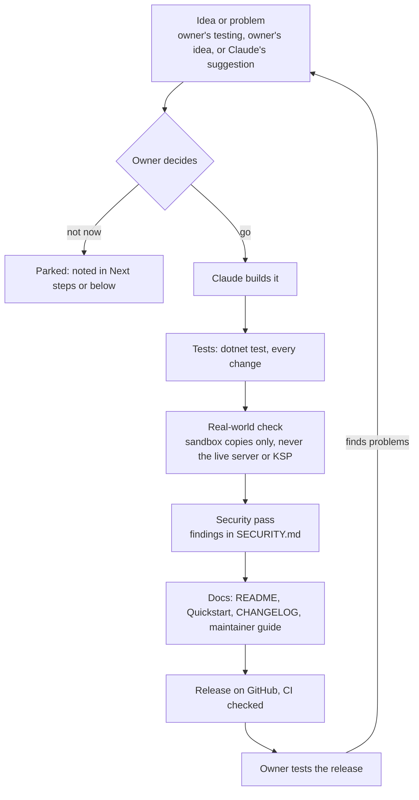

# Decisions

Who decided what in LUNA EVO, and what was done about it. The code is written by Claude (Anthropic's AI model, in
Claude Code), but it isn't left to make things up as it goes. The project owner
([@NEON-NULL-NARWHAL](https://github.com/NEON-NULL-NARWHAL)) sets the direction, picks what gets built, tests the
releases and has the last word. This page is the record, newest first.

## How a decision is made

When Claude makes a call itself (how to build something, or that something shouldn't be built the way it was
asked), it says so and why, and the owner can overrule it. Those calls are marked **Claude's call** below.

## Standing rules from the owner

- **Document everything.** Every change updates the README, Quickstart, CHANGELOG, the maintainer guide
  ([Meat and Potatoes](Meat%20and%20Potatoes/README.md)) and the project notes. "We cannot allow scope to mess with
  cleanness and accurate/safe/documented code."
- **A release for every change**, with tests and a security pass. The fix workflow is the flowchart above.
- **Be clear about the AI.** The README says who did what ([AI disclosure](README.md#how-this-app-was-made-ai-disclosure)).
- **Never test on the real thing.** No CKAN runs (not even dry runs) against the owner's KSP, no edits to the live
  server or KSP's settings: sandbox copies only. Game files may be read; saves are read carefully, never changed.
- **Keep personal data out.** The repo is public: no passwords, IPs, player names or user paths, and screenshots come
  from sanitized demo copies.
- **Audits get deeper as the project grows**, and the owner approves new features found during an audit before
  they're added ("free to add fixes, but only if you ask").
- **American English** across the app and docs.

## Log

| Date | Version | The owner decided | What was done |
|---|---|---|---|
| 2026-10-22 | 2.3.0 | "We've already split players in a way": deliver fixes as **patches through our app** instead of a separate LMP. Then start the live map, "your own way", following the research plan | Patch plan written up ([25](Meat%20and%20Potatoes/25-LMP-Under-The-Hood.md#delivering-fixes-as-patches-through-mission-control-owners-idea-2026-10-22)): a Harmony patch mod on the official LMP client plus a server plugin, never changing the protocol. Live map: positions from the running server's website, checked against the real 0.29.2 server |
| 2026-10-22 | - | Add this page; next, research how sound LMP's client and server really are, plan the map's next phases and a live game connection, choose focus areas, then a longer audit before posting publicly | This page. The research and the scope choices follow, and the open questions are listed at the bottom |
| 2026-10-21 | 2.2.0 | Build a 2D solar system map from the save and GameData ("phase 1"); Claude may read the game files and a copy of the server, carefully | Map page: vessels on their orbits, stock bodies plus planet packs from GameData. Checked against a read-only copy of the owner's universe; screenshots from a renamed copy |
| 2026-10-21 | - | Turn on GitHub's security features | Secret scanning with push protection, Dependabot, private vulnerability reporting |
| 2026-10-21 | 2.1.1 | Audit 10, "really dig deep"; new features only with the owner's OK | Audit 10 with fuzz testing. Three CKAN bugs reported upstream after the owner agreed ([#4726](https://github.com/KSP-CKAN/CKAN/issues/4726), [#4727](https://github.com/KSP-CKAN/CKAN/issues/4727), [#4728](https://github.com/KSP-CKAN/CKAN/issues/4728)). **Claude's call:** moving the Core tests to xunit v3 broke CI, so it was reverted |
| 2026-10-21 | 2.1.0 | Picked 9 of Claude's 16 suggestions, hardest first | Install the server's mods, the LMP version helper, browser ping/sort/save, CKAN "pick one" choices, Cancel, Copy log |
| 2026-10-21 | - | A Quickstart page "like Security and Contributing", with what each button really does | `QUICKSTART.md` with a **↳** line under every step. GitHub doesn't allow custom tabs, so it's linked from the top of the README instead |
| 2026-10-21 | 2.0.0-2.0.1 | Rename to **LUNA EVO Mission Control**; back up the repo first, then rename it on GitHub, "meticulously" | Backup made and test-restored first. Everything renamed; old copies still update (verified with the old updater) |
| 2026-10-20 | 1.4.0 | A list of problems from the owner's testing: versions shown, clickable warnings, allow parts, Essentials, editable cards, server browser, simple mode | All built. The "Install with CKAN" error couldn't be reproduced safely, so the page now explains CKAN's errors and has a dry run (**Check with CKAN**) |
| 2026-10-20 | 1.3.x | Audits listed newest first; use an existing ckan.exe; export and import CKAN mod lists; test them against the owner's real CKAN files | Done. Checked read-only on the owner's install: 108 mods, identical to the original modpack. CKAN's file holds the Windows user name, so LUNA EVO never copies it |
| 2026-10-20 | 1.1.0 | Fork CKAN as "LNAKAN" so there are no mismatched copies; let LUNA EVO download CKAN and LMP any time | **Claude's call:** no fork for now. LUNA EVO downloads and verifies the official CKAN instead, which solves the mismatch without maintaining a fork (reasoning in [chapter 22](Meat%20and%20Potatoes/22-CKAN-and-LMP-Client.md)). The downloads were built as asked |
| 2026-10-20 | - | A Kystack server browser: liked, but CKAN came first | Parked. The in-app server browser (1.4.0) uses LMP's existing master servers |
| 2026-10-20 | 1.0.0-1.0.1 | "What would you like for 1.0?", then an audit | Vessel cleanup (Claude's suggestion), audit 4 |
| 2026-10-20 | 0.8.0-0.9.0 | **Declined** the "Recommended for a mesh server" button. Chose settings search, chat announcements and a home server mode, then 5 more items; the chat tab was parked | Built as chosen |
| 2026-10-20 | - | Engine plumes on other players' ships? | **Claude's call:** not a quick server fix. It's in the LMP client, so it went on the fork list |
| 2026-10-20 | 0.7.0 | Owner's idea: share vessels | Craft designs first (`.lunacraft`); flying vessels parked as riskier |
| 2026-10-20 | 0.6.0 | Self-update from GitHub; less cluttered menus | Updater with verified downloads; rail cut from about 20 entries to 8, with tabs. The owner then made the repo **public** so updates work |
| 2026-10-20 | 0.4.0-0.5.0 | Owner's review found the unencrypted Discord webhook and unchecked downloads; asked for a security audit, a Join page for players, and "tear out Discord for now" | SHA-256 checks on every download, audit 1, Join page, Discord removed. In 0.5 the owner picked notifications from a list, and Discord came back **encrypted** (DPAPI), with mentions blocked |
| 2026-10-20 | 0.3.0 | "Build all of it" from Claude's list | Setup wizard, LMP updater, players page, mod control from GameData, automation |
| 2026-10-20 | 0.2.0 | An RGB color wheel, an app settings page, run the server and see its logs inside the app | Server console with clean Ctrl+C stop, settings page |
| 2026-10-20 | 0.1.0 | Fork-first plan; call it **LUNA EVO**; take the look from NOMM; build a GUI config manager first | Avalonia 12 on .NET 10, the owner's preference. The settings come from the server's own `Server.dll`, and the XML is edited in place with backups |
| 2026-10-20 | - | Repo on GitHub, GPL-3.0, with a README, the maintainer guide and an AI disclosure | Done |

## Open: waiting on the owner

From the LMP research ([Meat and Potatoes 25](Meat%20and%20Potatoes/25-LMP-Under-The-Hood.md)). Claude's
recommendation is in **bold**. Decided on 2026-10-22: fixes go out as patches through Mission Control (was O1), and
the live map comes first (was O2).

| # | Question | Options |
|---|---|---|
| O3 | In-game testing on the owner's PC | **A sandbox stock KSP 1.12.5 copy (two for multiplayer tests) with kRPC and the LMP client, run only when the owner says so**; never the modded install |
| O4 | The longer audit before posting publicly | **After the next milestone (the LUNA EVO server plugin)**, so it covers the plugin; or now, on Mission Control as it is |
