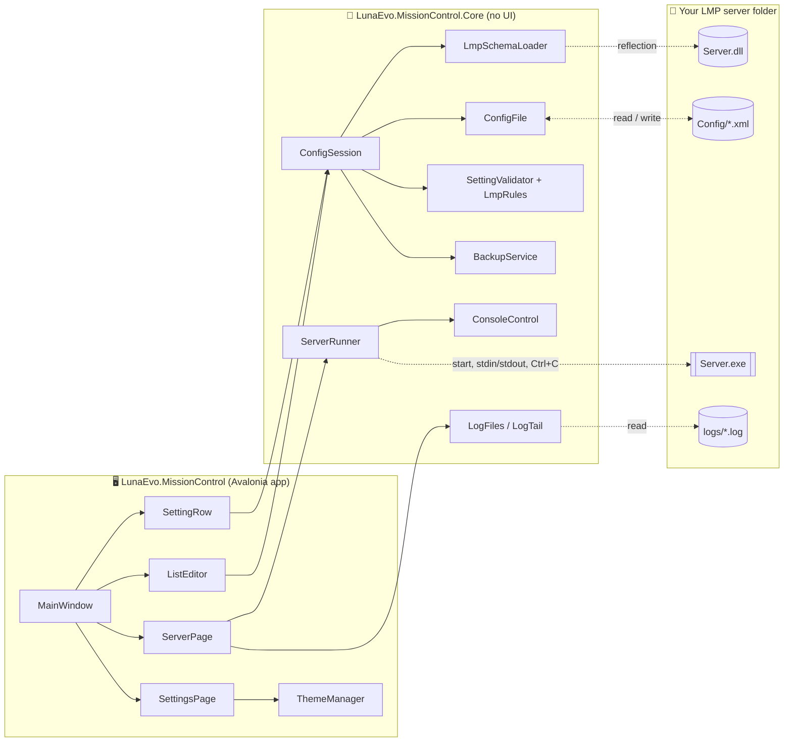

# 01 · Architecture

[← Meat and Potatoes](README.md)

## Two projects, one rule

**The rule:** anything that can be decided without a screen lives in **Core**. The app only turns Core's answers into
controls. That's why most behavior is tested with plain unit tests, and the UI tests only need to check the wiring.

## The life of a setting

1. **Discover.** `LmpSchemaLoader` loads `Server.dll` from the server folder (into a throwaway, unloadable
   `AssemblyLoadContext`, from bytes, so the file isn't locked). It finds every `*SettingsDefinition` class plus
   `ModControlStructure`, and for each property records its name, type, default (from a fresh instance), description
   (from LMP's `[XmlComment]` attribute) and limits (parsed from that description by `CommentRules`).
2. **Load.** `ConfigSession.Open` loads each XML file as a `ConfigFile` and snapshots every value, so it can tell later
   what changed.
3. **Show.** `MainWindow` builds one page per file. Each setting becomes a `SettingRow`, which picks a control from
   the setting's `SettingKind` (Bool → switch, Integer/Decimal → number box, Enum → dropdown, Text → text box,
   StringList → `ListEditor`).
4. **Edit.** A control's change event calls `ConfigSession.SetValue`, which edits that one XML element in memory and
   marks the file dirty. Then `MainWindow.Refresh` runs: it calls `Validate()` once and every row updates its message,
   greying, "modified" marker and reset button.
5. **Save.** `ConfigSession.Save` backs up the dirty files, writes them, prunes old backups, and re-snapshots.

## The life of a server run

1. **Start.** `ServerPage.StartAsync` checks for unsaved changes, config errors and the .NET runtime, then calls
   `ServerRunner.Start`.
2. **Run.** `ServerRunner` starts `Server.exe` with no window and redirected stdin/stdout. Each output line becomes a
   `LogLine` on a background thread; `ServerPage` queues them and moves them into the console every 100 ms.
3. **Command.** The command box writes a line to the server's stdin. LMP echoes `Command input: ...` and replies.
4. **Stop.** `ServerRunner.StopAsync` asks `ConsoleControl` to send Ctrl+C (via a helper process), waits for LMP's
   clean exit, and only kills it after the timeout.

## Threads

- The UI runs on Avalonia's UI thread.
- Server output and `LogTail` arrive on background threads and are **only queued** there (`ConcurrentQueue`); a
  `DispatcherTimer` drains the queue on the UI thread. State changes are posted with `Dispatcher.UIThread.Post`.
  Don't touch controls from a background thread.

## Why it's built this way

| Decision | Why |
|---|---|
| Read the schema from `Server.dll` at runtime | New or renamed LMP settings show up with no code change, and the app always matches the server it's pointed at. |
| No compile-time reference to LMP | The same exe works with any LMP version and we don't drag LMP's dependencies in. |
| Edit XML in place (`XDocument`) | Comments, order and formatting survive; a diff shows exactly what changed. |
| Generate controls in code, styles in XAML | Every row is built from data, which is easier in code; all the look lives in `App.axaml` in one place. |
| Single self-contained exe | Nothing to install on the server PC; drop it next to `Server.exe`. |
