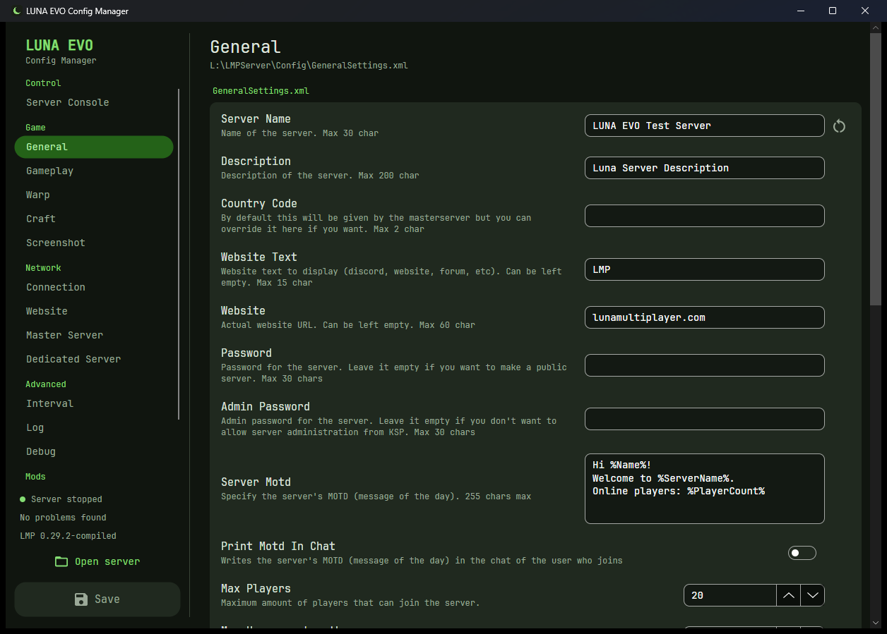
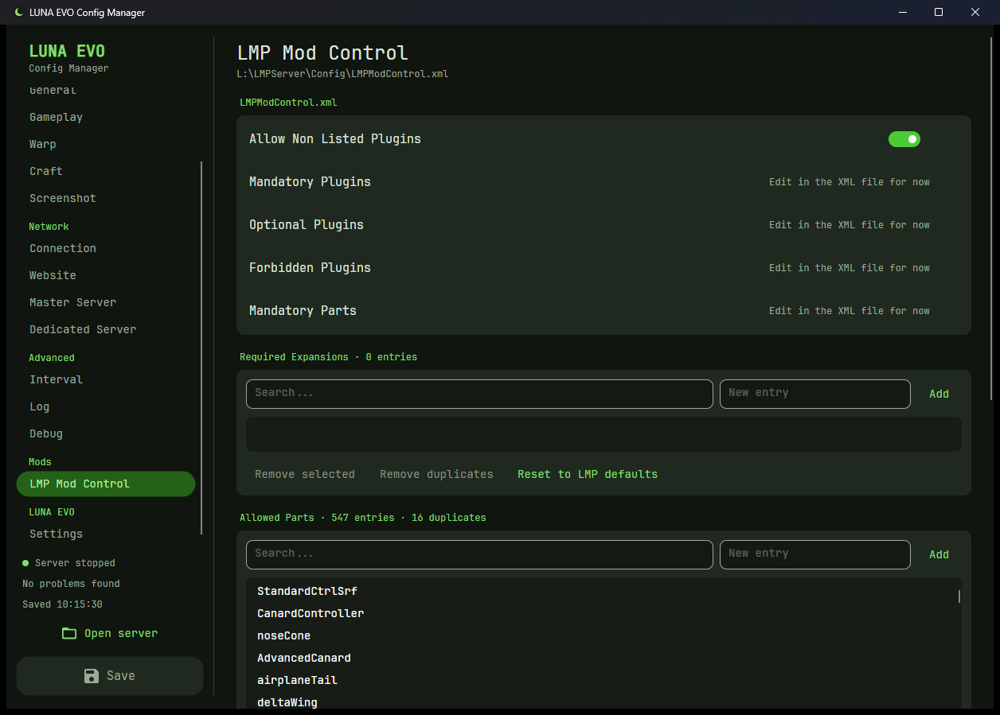
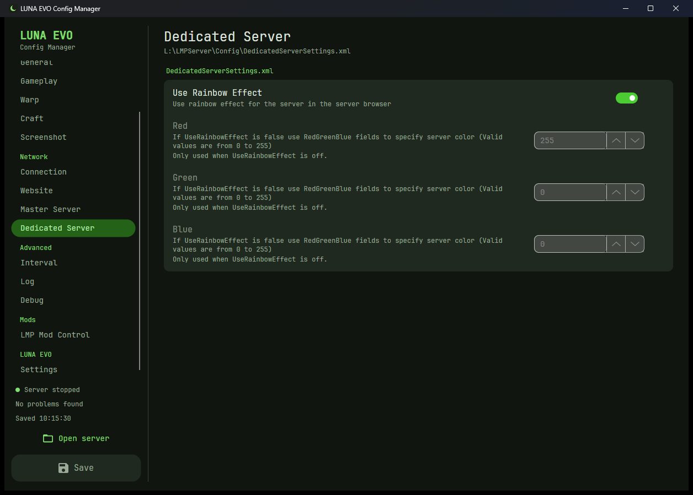

<div align="center">


# LUNA EVO Config Manager

**A desktop app to configure, run and watch a [Luna Multiplayer](https://github.com/LunaMultiplayer/LunaMultiplayer) (LMP) server for Kerbal Space Program, without hand-editing XML or keeping a console window open.**

Version 0.2.0 · Windows · .NET 10 · Avalonia 12 · GPL-3.0

</div>

> [!TIP]
> **New to the code? Start in [`Meat and Potatoes/`](Meat%20and%20Potatoes/README.md).**
> It's the maintainer's guide: a map of every folder and file with a symbol legend, how the pieces fit together,
> the LMP quirks we discovered, and step-by-step recipes for common changes.

> [!NOTE]
> **This app was written with AI.** The code, tests and docs were written by Claude (Anthropic's AI model) through
> Claude Code, directed and reviewed by the project owner. See [How this app was made](#how-this-app-was-made-ai-disclosure)
> for exactly who did what and how it was checked.



## What it does

LUNA EVO is the first project of **LUNA Evolved**: two friends improving Luna Multiplayer. LMP's server is configured
through 13 XML files and run from a console window. This app replaces both:

| | |
|---|---|
| ⚙️ **Edit every setting in a GUI** | Each of LMP's 13 config files gets a page. Every setting gets the right control: switches, number boxes, dropdowns, text boxes and a multi-line MOTD editor. LMP's own description for each setting is shown under its name. |
| 🔍 **Always matches your server** | The settings list is read **from your server's own `Server.dll`**, so when LMP adds or renames a setting it shows up automatically. No hard-coded list to go stale. |
| ✅ **Validation before you save** | Limits come straight from LMP's descriptions (`Max 30 char`, `Min value = 5000`, `From 0% to 100%`), plus rules LMP only mentions in passing: heartbeat must be lower than timeout, game and website ports mustn't clash, dropdowns are case-sensitive. Problems show inline, as red badges in the navigation, and block saving. |
| 🌗 **Greys out what doesn't apply** | Red/Green/Blue only matter when the rainbow effect is off; funds and reputation only in Career mode; science only in Career and Science. |
| 🎯 **Knows LMP's hidden behaviour** | Gameplay "defaults" follow your difficulty preset (Easy/Normal/Moderate/Hard), and you're warned when your edits will make the server silently switch to *Custom*. |
| 💾 **Safe saving** | Files are edited **in place**: comments, order, line endings and encoding are preserved byte-for-byte. Every save makes a timestamped backup first, and old backups are pruned. |
| 🧩 **Mod control editor** | Searchable lists for allowed parts, resources and required expansions, with one-click **Remove duplicates** (our real file had 16!) and reset to LMP's defaults. |
| ▶️ **Run the server from the app** | Start, stop and restart with a live, colour-coded console, filters, search, a command box with history and quick commands, and a browser for every log file. Stops are **clean** (LMP backs up the universe), not a kill. |
| 🎨 **Make it yours** | An RGB colour wheel and KSP-themed presets regenerate the whole theme; dark, light or follow Windows. |
| 📦 **One file** | A single self-contained `.exe` (no .NET install needed). Drop it next to `Server.exe` and it finds the server by itself. |

## Screenshots

| | |
|:---:|:---:|
|  |  |
| **Server Console:** the real LMP server running inside the app, answering `/help` and `/countclients`. | **Validation:** errors inline, a badge on the page, and the count in the status area. |
|  |  |
| **Log files:** every `lmpserver_*.log`, colour-coded. | **Gameplay:** Career-only settings greyed out in Sandbox, with the reason. |
|  |  |
| **Mod control:** searchable part lists with duplicate removal. | **Dependent settings:** colours disabled while the rainbow effect is on. |
|  |  |
| **LUNA EVO Settings:** colour wheel, presets, theme, behaviour, versions. | **Light theme.** |

<sub>Screenshots are from a sandbox copy of a real LMP 0.29.2 server with personal details removed.</sub>

## Getting started

### Use it

1. Get `LunaEvo.ConfigManager.exe` (build it with `publish.ps1`, see below).
2. Put it in your LMP server folder, next to `Server.exe`, and double-click it.
3. Edit, **Save** (Ctrl+S), then use **Server Console → Start**.

Running the server itself still needs what LMP needs: LMP 0.29.x requires the [.NET 6 Runtime](https://dotnet.microsoft.com/en-us/download/dotnet/6.0).
LUNA EVO checks for it and links you to the download if it's missing.

> [!IMPORTANT]
> LMP reads its config only when it starts, and rewrites the files as it does. Save your changes, *then* (re)start the server.
> LUNA EVO warns you if you save while it's running.

### Build it

Requirements: Windows, the [.NET 10 SDK](https://dotnet.microsoft.com/download/dotnet/10.0).

```powershell
dotnet build                     # build everything
dotnet test                      # 85 tests: core logic and the real UI, headless
.\publish.ps1                    # -> dist\LunaEvo-ConfigManager-<version>-win-x64\LunaEvo.ConfigManager.exe
```

Run from source against the copies in `tests/Fixtures` (no real server needed):

```powershell
dotnet run --project src/LunaEvo.ConfigManager --launch-profile "Fixtures (in repo)"
```

Command-line options: `--server <folder>` (contains Server.dll), `--config <folder>` (defaults to `<server>\Config`),
`--settings <file>` (LUNA EVO's own preferences, for portable use; defaults to `%APPDATA%\LunaEvo\ConfigManager\settings.json`).

## Repository layout

```
ConfigManager/
├── Meat and Potatoes/        📖 the maintainer's guide: start here
├── src/
│   ├── LunaEvo.ConfigManager.Core/   🧠 all the logic, no UI (schema, XML editing, validation, server control)
│   └── LunaEvo.ConfigManager/        🖥️ the Avalonia desktop app
├── tests/
│   ├── LunaEvo.ConfigManager.Core.Tests/   🧪 logic tests
│   ├── LunaEvo.ConfigManager.Tests/        🧪 UI tests (the real window, driven headlessly)
│   ├── FakeLmpServer/                      🧪 a pretend Server.exe so server control can be tested safely
│   └── Fixtures/                           🧪 sanitized real configs + LMP 0.29.2's Server.dll
├── docs/screenshots/
├── publish.ps1               📦 builds the single-file exe
└── CHANGELOG.md
```

The full file-by-file map is in [`Meat and Potatoes/README.md`](Meat%20and%20Potatoes/README.md).

## How this app was made (AI disclosure)

We want to be completely clear about this.

**Who did what**

| The project owner (human) | Claude (AI), via Claude Code in VS Code |
|---|---|
| Set the goals: a GUI config manager first, then server control, theming and this repo. | Read LMP's source to learn how settings, logging, commands and shutdown really work. |
| Made the decisions: desktop app over web panel, Avalonia, .NET 10, private repo, GPL-3.0, the look (inspired by [NOMM](https://github.com/Combat787/NOMM)). | Wrote all of the code: the C#, XAML and build scripts. |
| Supplied the real server, its configs and the requirements (validation rules, greying out, dedupe...). | Wrote all 85 automated tests, plus a fake LMP server to test against. |
| Reviewed the results and screenshots, and asked for changes. | Ran the tests, live-tested against a real LMP server in a sandbox, took the screenshots, and wrote these docs. |

- **Model and tool:** Claude Opus 5.5 by Anthropic, working in Claude Code (an AI coding agent that can read files, run commands and build/test the code) inside VS Code.
- **When:** October 2026, in a single long working session.
- **How much:** essentially every line in this repo was written by the AI. The human role was direction, decisions, review and testing.

**How we checked it**

AI-written code can look right and still be wrong, so nothing here is trusted on looks:

- **85 automated tests.** Logic tests cover byte-for-byte file round trips, every validation rule, the schema read from LMP's real `Server.dll`, and starting/commanding/stopping a server. UI tests open the real window and click through **every tab and every control**.
- **Live test** against the real LMP 0.29.2 server, in a sandbox copy with networking features off: start, `/help`, `/countclients`, and a clean stop where LMP made its backup and exited with code 0.
- **Visual checks**: every page was screenshotted and reviewed during development.

The tests caught real mistakes along the way, which is why they exist. For example, an early way of sending Ctrl+C made every
*later* server ignore it (Windows passes the "ignore Ctrl+C" flag down to child processes), and LMP's files declare
`encoding="utf-16"` but are actually UTF-8, which crashes the standard XML loader. Both are documented in
[`Meat and Potatoes/07-LMP-Gotchas.md`](Meat%20and%20Potatoes/07-LMP-Gotchas.md), and the full story of the AI workflow is in
[`Meat and Potatoes/09-How-It-Was-Built.md`](Meat%20and%20Potatoes/09-How-It-Was-Built.md).

**What that means for you:** treat this like any open-source project. Read the code, run the tests, and keep the backups
it makes. The exe isn't code-signed, so Windows SmartScreen may warn the first time you run it.

## Credits and licences

- **LUNA EVO Config Manager**: GPL-3.0, see [LICENSE](LICENSE).
- **[Luna Multiplayer](https://github.com/LunaMultiplayer/LunaMultiplayer)** by Gabriel Vazquez and contributors: MIT. LUNA EVO contains no LMP source code; it reads your server's `Server.dll` at runtime. The test fixtures include LMP 0.29.2's server binaries under their MIT licence ([`tests/Fixtures/LMPServer/LMP-LICENSE.txt`](tests/Fixtures/LMPServer/LMP-LICENSE.txt)).
- **[Avalonia UI](https://avaloniaui.net/)**: MIT.
- **[JetBrains Mono](https://github.com/JetBrains/JetBrainsMono)** font: SIL Open Font License 1.1 ([`Assets/Fonts/OFL.txt`](src/LunaEvo.ConfigManager/Assets/Fonts/OFL.txt)).
- **Material Symbols** icons by Google: Apache 2.0.
- Look and feel inspired by **[NOMM](https://github.com/Combat787/NOMM)**, the Nuclear Option Mod Manager.

Kerbal Space Program is a trademark of Take-Two Interactive. This project isn't affiliated with them or with the LMP team.
