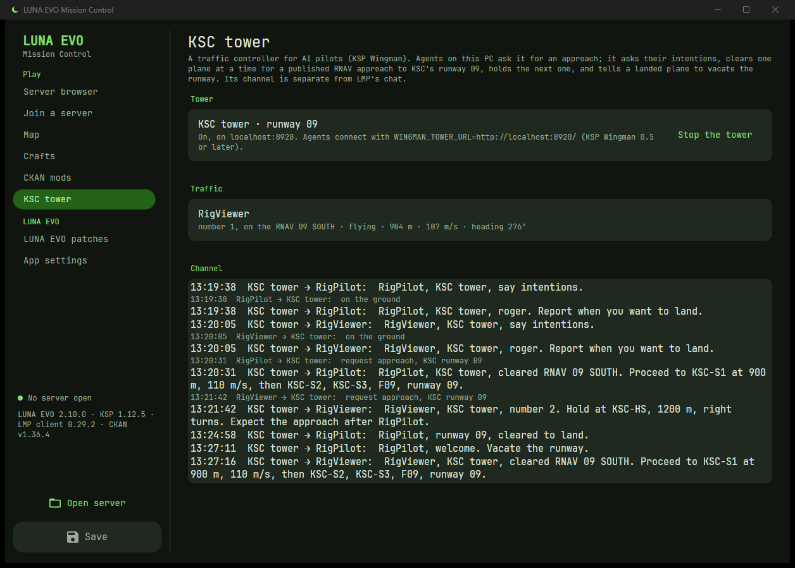
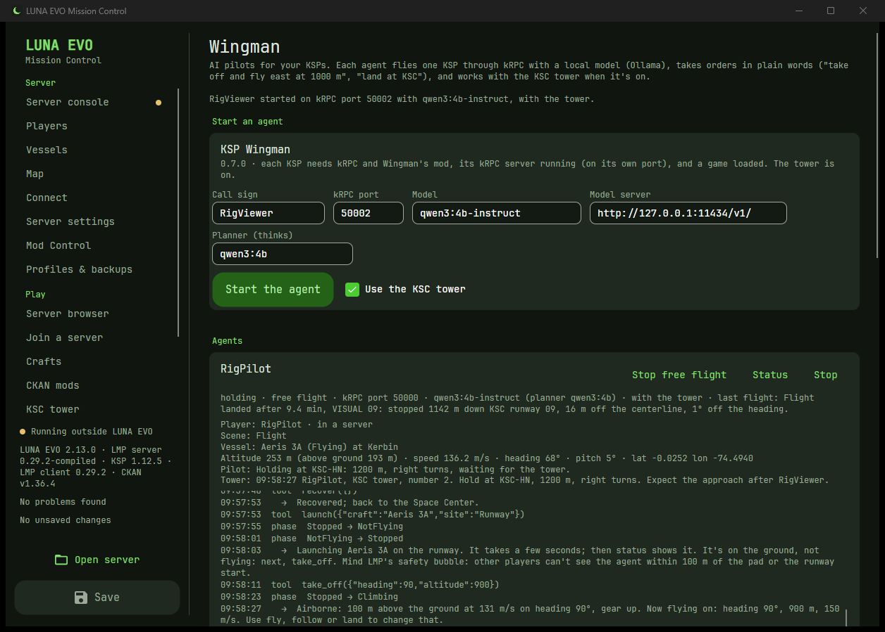

# What LUNA EVO Mission Control does

Everything, for hosts and players. The short version is in the [README](../README.md).

## Host a server

| | |
|---|---|
| 🧙 **Setup wizard** | Pick a folder and answer a few questions (name, password, mode, difficulty, players, port). LUNA EVO downloads the LMP server from GitHub, writes the config before it ever starts, and installs the .NET runtime it needs. Private by default. It can also get CKAN and the matching LMP client for you. |
| ▶️ **Server console** | Start, stop and restart, with a live color-coded console, filters, search, commands with history and quick buttons, and a log file browser. **Cards at the top** (name, game port, max players...) change a setting right there. Live memory and CPU. Stops are clean (LMP saves the universe), never a kill. |
| 🔌 **Connect** | The exact addresses to give friends (LAN, VPN/mesh, internet), a one-click firewall rule, whether the port is listening, **Share with players** for live info, **Copy invite** (a message friends paste straight into their Join page) and **Export my mod list** for them to install. |
| 👥 **Players** | Who's online, their vessels and warp subspaces, **Kick** and **Ban**. Click a card for the list of just those players, vessels or asteroids. |
| 📜 **History, alerts, bans** | Everyone who's played (last seen, time played, your notes; never IPs). Alerts for admin-password guessing and banned players returning. LMP's ban list with names, and **Unban**. |
| 🔔 **Notifications** | Windows notifications and an optional Discord channel: server up, stopped or crashed, alerts, joins and leaves. The webhook is stored encrypted; posts can never ping @everyone. |
| ⬆️ **LMP updates** | A newer LMP server in one click, keeping your Config, Universe, logs and Plugins, and saving the old version. |

## Find, mod and join (for players)

You don't have to host anything: choose **Join a friend's server** on the welcome page, or open **Play** in the rail.

| | |
|---|---|
| 🌍 **Server browser** | Every public LMP server, the list LMP shows in game: search, sort by players or ping, only your LMP version, no password, has players. **Save** to My servers; **Join** asks for the password if there is one, checks the server and gets you ready to launch. |
| 🛰️ **Check a server** | A friend's address: its network (this PC, LAN, VPN/mesh, internet), your ping, and, if the host shares it, name, mode, players and vessels. |
| 🔢 **Right LMP version** | Join knows the server's LMP version (from the browser or the invite) and offers **Install LMP x.y.z** when yours doesn't match. |
| 🚀 **Launch KSP straight in** | One button: KSP starts with CKAN's options and LMP connects by itself. Servers with a password or another port go to the top of LMP's server list, password included. |
| 🧰 **CKAN mods** | **Install the server's mods** from the list your host sent, or check and install any mod list (a `.ckan` modpack or mod names). When a mod needs "one of several" others, you pick (CKAN's command line would quietly leave it out). Cancel, Copy log, CKAN's errors in plain words, and **export** your own list for friends. Uses LUNA EVO's verified CKAN or yours. |
| 🧩 **Check my mods** | Your GameData against a server's mod rules, exactly as LMP checks them: banned, missing or wrong-version mods, missing parts, parts it would drop. Hosting it? **Allow them on my server** in one click. |
| 📦 **LMP client** | Install the LMP client mod in the server's version into any KSP install, your CKAN ones included (App settings → Downloads). |
| 🚀 **Crafts** | Export a craft to a `.lunacraft` file for friends; import theirs into your save or the server, with a missing-parts check. |
| 📌 **My servers** | The servers you play on, saved. Passwords never are. |

## Configure it

| | |
|---|---|
| ⭐ **Essentials first** | Server settings opens with the dozen settings most servers need. **Simple mode** (App settings → Behavior) hides everything else until you want it. |
| ⚙️ **Every setting, in a GUI** | All 13 LMP config files as tabs, grouped Game / Network / Advanced; every setting with the right control and LMP's own description. **Search** finds any of them. |
| 🔍 **Always matches your server** | The settings list is read **from your server's own `Server.dll`**, so new or renamed LMP settings appear by themselves. |
| ✅ **Validation** | LMP's limits plus the rules it only mentions in passing (heartbeat < timeout, port clashes). Problems show inline and block saving; the problem count in the rail lists them and jumps to each. Weak passwords get a warning and a **Generate** button (LMP doesn't limit guesses). |
| 🧾 **Review before saving** | Every change as old → new before anything is written, and a timestamped backup on every save. |
| 🎯 **Knows LMP's quirks** | Grays out what doesn't apply (rainbow colors, Career-only funds), follows the difficulty preset, and warns before LMP silently switches you to *Custom*. |
| 🧩 **Mod Control** | **Import from GameData** fills the allowed parts, resources, plugins (with SHA-256) and expansions the way LMP's own generator does; every list is editable, and **Share these rules with players** gives friends a file to check against. |

## Keep it running

| | |
|---|---|
| 🏠 **Home server mode** | For an always-on PC: starts with Windows in the notification area, starts the server, hides instead of quitting, keeps the PC awake while it runs. |
| 🔄 **Restarts** | After a crash (giving up if it keeps crashing), and an optional daily restart with an in-game warning. |
| 🌌 **Universe backups** | Dated snapshots on demand, every few hours, every time the server stops and before every LMP update. One-click restore, which backs up first. |
| 🧹 **Vessel cleanup** | Remove debris, asteroids and abandoned ships (server stopped, backed up first, crewed ships protected): the biggest performance win a host has. |
| 🪐 **Solar system map** | Every vessel on the server on its orbit, where it is now (live while the server runs; every second, with who flies what, with the optional LUNA EVO server plugin), around every body, including the planet packs in your GameData (OPM, MPE and other Kopernicus packs). Zoom, pan, click a ship for its orbit and crew. |
| 💬 **Chat announcements** | Messages to the game chat on a schedule ("every 60 minutes: join our Discord"). |
| 🗂️ **Config profiles** | Save the whole setup as "Career campaign" or "Sandbox chaos night" and switch in one click. |

## Fixes for LMP itself

All on one page: **LUNA EVO patches** in the rail (2.10), with Install, Update or Remove for your KSP (players) and your server (hosts).
Each fix was measured in a real game before and after. Nothing new goes over the network, so you still play with people
who don't have them.

- **Join on any port, with a password:** KSP joins a server by itself (LMP's own option breaks its startup when there's a port).
- **Stay together in time:** a player alone on the server no longer gets time jumps that leave their vessel behind, and
  players stay in step with each other by themselves (2.9.1).
- **Positions with the right time** (they were one physics tick early).
- **Less lag and far fewer lost vessel updates** on a jittery connection (2.7: 29 → 22 ms, 63% → 18% lost).
- **A LUNA EVO button in KSP** (2.8): your connection, who's online and what they fly, a clock sync, watching a nearby
  player's vessel, and LMP's settings in one window.

How each was found and measured: [the LUNA EVO patches](../Meat%20and%20Potatoes/27-Client-Patches.md).

## AI pilots: the KSC tower

**KSC tower** (2.11, rail: Play → KSC tower): a traffic controller for AI pilots
([KSP Wingman](https://github.com/NEON-NULL-NARWHAL/ksp-wingman) 0.5). It asks each agent's intentions, clears one at
a time for a published RNAV approach to KSC's runway 09 with the whole route, holds the next plane (stacked 300 m
apart), says "cleared to land" on final, and tells a landed plane to vacate the runway; then it clears the next one.
The page shows the planes (their number, approach, height, speed) and the whole conversation, on the tower's own
channel, not LMP's chat. Every message is also kept as data (`logs/tower-<date>.jsonl`). Start it on the page, or
start LUNA EVO with `--tower`; agents connect to `http://localhost:8920/`. Close in with nobody waiting, it clears a
**short visual** instead of a long RNAV route (2.13). **Talk on LMP chat** says its lines and the agents' calls in the
server's chat as "KSC tower" (with the LUNA EVO server plugin), so everyone hears the traffic.

How it works: [chapter 28](../Meat%20and%20Potatoes/28-Tower.md).

## AI pilots: KSP Wingman

**Tools (for AI pilots)** (2.12, on LUNA EVO patches): installs [KSP Wingman](https://github.com/NEON-NULL-NARWHAL/ksp-wingman)
from its GitHub releases (checked against GitHub's checksum) and keeps it up to date, puts its mod into your KSP (the
folder from Join; KSP must be closed), checks that kRPC is there (Wingman flies through it; get it on the CKAN page),
and finds [Ollama](https://ollama.com) on this PC, with a button to download the model Wingman is tested with.

**Wingman** (rail: Play → Wingman, once it's installed): start an AI pilot for a KSP (its kRPC port), with a model and,
if it's on, the KSC tower. Each agent has a card: its flight phase, its last flight (landed, and where on the runway it
stopped), the plane's height and speed, everything it does (your orders, its tool calls and answers, the tower's
messages), and a box for orders in plain words ("take off and fly east at 1000 m", "land at KSC"). Stop asks it to quit;
the plane keeps its last orders. `--wingman-agent CallSign:port[:model]` starts agents with LUNA EVO.

**Free flight and learning** (2.13): the card's **Free flight** button lets an agent practise landings on its own for
half an hour: a planner model that thinks ("Planner (thinks)", e.g. qwen3:4b) picks what to practise, weakest first,
the agent flies it inside a box around KSC (gemma4:e4b is the suggested planner: fast, and it fits next to two KSPs), and after each flight it writes a lesson. **What the agents know** on the
same page is the server's tech tree: six skills graded from every agent's real flights (each opens once what it needs
has 3 good flights), and the lessons, each tied to the flight it came from (delete any you don't like). It's kept on the
server (`LunaEvo/agents/knowledge.json`), so every agent there learns from the others.

How it works: [chapter 29](../Meat%20and%20Potatoes/29-Wingman.md) and [chapter 30](../Meat%20and%20Potatoes/30-Knowledge.md).

## The app itself

| | |
|---|---|
| 📦 **One file** | A single self-contained `.exe`. Next to `Server.exe` it opens that server by itself. |
| ⬆️ **Updates itself** | Checks its GitHub releases on startup; **Update and restart** verifies the download, swaps the exe and restarts. |
| 🧭 **Easy to find your way** | One rail: Server (console, Players, Vessels, Map, Connect, Server settings, Mod Control, Profiles & backups), Play (Server browser, Join, Crafts, CKAN mods) and App settings, with every version in use (LUNA EVO, LMP server and client, KSP, CKAN) at the bottom. |
| 🎨 **Make it yours** | An RGB color wheel and KSP-themed presets regenerate the whole theme; dark, light or follow Windows. |

## Safe by default

| | |
|---|---|
| 🔒 **Verified downloads** | LMP, CKAN, the LMP client and LUNA EVO itself come only from GitHub over HTTPS and are checked against GitHub's SHA-256 before use. |
| 💾 **Backups everywhere** | Before every save, update, restore and change to LMP's server list. Config files are written through a temp file, so a crash can't leave a broken one. |
| 🏠 **Private until you say so** | New servers aren't listed, don't touch your router and keep live info on this PC. A banner says whenever UPnP or the public list makes the server reachable from the internet. |
| 🤫 **No secrets in the open** | LUNA EVO never stores passwords; a Discord webhook is encrypted for your Windows account. No telemetry, no account. |
| 🧾 **Error log** | Anything unexpected goes to `%APPDATA%\LunaEvo\MissionControl\logs\errors.log` instead of crashing, so a bug report can say what happened. |
| ⚠️ **Warns before it matters** | Saving while the server runs, stopping it with players on, closing with unsaved changes, settings LMP would reject. |

## Tested with

| Software | Version tested |
|---|---|
| Windows | 11 (x64); LUNA EVO is Windows-only |
| Luna Multiplayer server | **0.29.2** (run for real); 0.30.0's settings match 0.29.2's |
| Luna Multiplayer client mod | **0.29.2** |
| Kerbal Space Program | **1.12.5** (Steam, modded) |
| CKAN | **1.36.4** |

Which LUNA EVO version was checked against what, release by release, is in [`SECURITY.md`](../SECURITY.md#audit-and-test-history).

## What it connects to

Everything is local except, and only when you use them: **GitHub** (LMP's, CKAN's and LUNA EVO's releases, for the
wizard, the CKAN page and update checks; the update checks can be turned off), **LMP's own website on this PC** (for
the Players page), **the server you type on the Join page** (a DNS lookup, 4 pings and its LMP website), **LMP's
master servers** for the server browser (one HTTPS request each, when you open it or press Refresh), **CKAN** when you
install a mod list (it downloads from its own catalog), and **your Discord webhook** if you add one. The **KSC
tower**, when you start it, listens on this PC only (localhost:8920) for KSP Wingman agents; nothing from outside can
reach it. **KSP Wingman**, when you install it, comes from its GitHub releases; agents you start talk to the model
server you give them (Ollama on this PC by default). Details are in
[`SECURITY.md`](../SECURITY.md).
