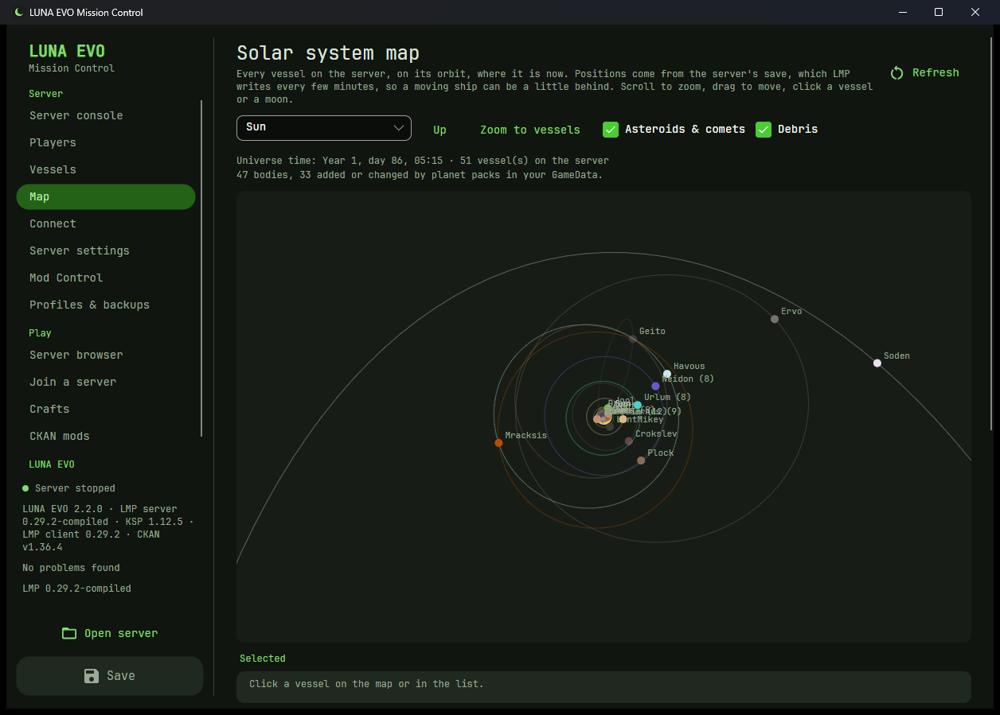
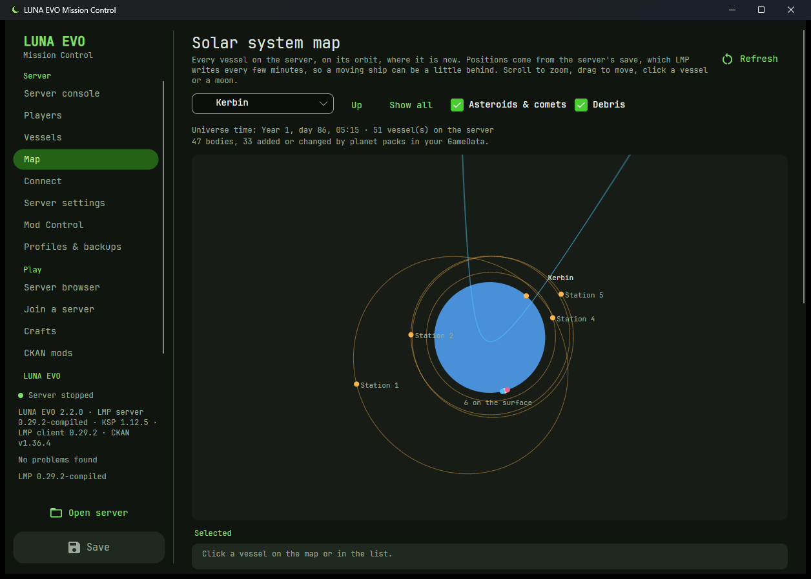
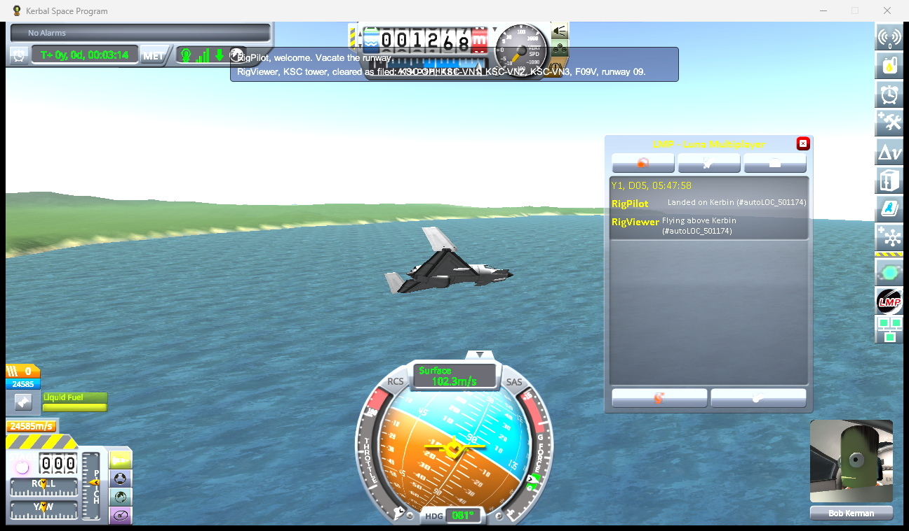

# Screenshots

**Hosting**

| | |
|:---:|:---:|
|  |  |
| **Setup wizard:** a few questions, then LMP is downloaded and configured. | **Server console:** the real LMP server running inside the app. |
|  |  |
| **Connect:** what to tell your friends, and what might block them. | **First start:** LMP's own startup, inside the app. |
|  |  |
| **Players:** live from LMP, with alerts for password guessing and banned players. | **History and bans:** sessions, time played, notes; unban by name. |
|  |  |
| **Server health:** memory, CPU and threads of the running server. | **Vessel cleanup:** debris selected, crewed ships protected, backup first. |
|  |  |
| **Solar system map:** 47 bodies with Outer Planets and other packs, read from GameData. | **Around Kerbin:** stations on their orbits, landed craft on the surface. |

**Playing**

| | |
|:---:|:---:|
|  |  |
| **Join a server:** network, ping and live server info. | **Launch KSP and join:** straight in, or via LMP's list. |
|  |  |
| **CKAN mods:** which CKAN, your installs, check and install a mod list. | **Join + CKAN:** pick a CKAN install; launch with its options. |
|  |  |
| **Check my mods:** what LMP will refuse, before you join. | **Crafts:** export your designs, import friends', with a missing-parts check. |
|  |  |
| **LMP client:** into any KSP install, any version. | **Setup wizard:** also get CKAN and the matching LMP client. |

**Configuring and running**

| | |
|:---:|:---:|
|  |  |
| **Essentials:** the settings most servers need, first. | **Server settings:** a tab per LMP file; Career-only settings grayed out in Sandbox, with the reason. |
|  |  |
| **Validation:** errors inline, badges on the tabs, the count in the rail. | **Search:** any setting, across the tabs. |
|  |  |
| **Import from GameData:** fill Mod Control from a KSP install. | **Plugin lists:** LMP's DllFile entries, editable. |
|  |  |
| **Profiles & backups:** switch whole configs; snapshot and restore the Universe. | **Log files:** every `lmpserver_*.log`, color-coded. |
|  |  |
| **Automation & alerts:** restarts, Universe backups, notifications. | **Chat announcements:** messages to game chat on a schedule. |
|  |  |
| **Home server mode:** one switch for an always-on PC. | **A Windows notification** from LUNA EVO. |
|  |  |
| **App settings:** color wheel, presets, theme. | **Updates:** LUNA EVO updates itself from its GitHub releases. |
|  |  |
| **Light theme.** | **Welcome:** host, open a server, or just play. |
|  |  |
| **KSC tower (2.11):** two KSP Wingman agents in the test rig, one cleared, one holding. | **Wingman (2.12):** two AI pilots started from LUNA EVO, parked after landing and taxiing off, with their status and events. |
|  | |
| **The radio in KSP (2.15):** the tower's lines at the top of a player's screen. | |

Screenshots are LUNA EVO 0.6 to 2.2 (older ones still say "Config Manager", its name before 2.0) running a sandbox copy of a real LMP 0.29.2 server, with personal details removed: network addresses are examples and the players are made-up Kerbals. The setup wizard is shown step by step in [Set up a new server](HOSTING.md#set-up-a-new-server-step-by-step).
